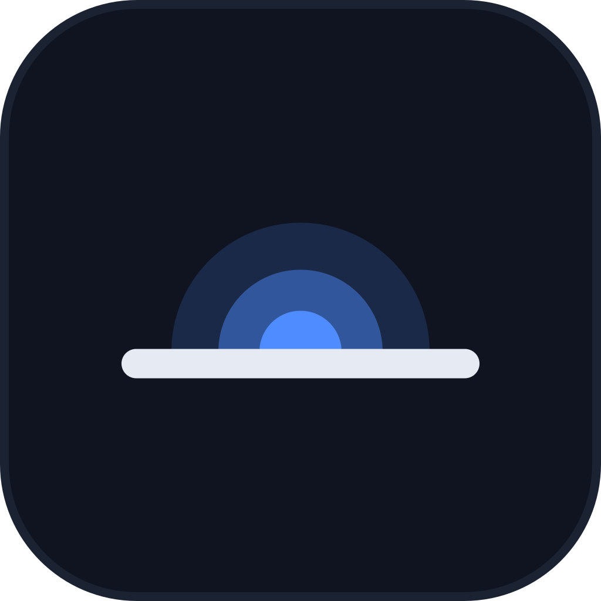

<p align="center">
  
</p>

<h1 align="center">Lucerna</h1>

<p align="center">
  A fast, minimal code editor. Written in Rust. No AI inside.
</p>

---

Your agent writes the code in Claude Code, Codex or a desktop app. Lucerna is where you read it:
browse the project, see what the agent just changed, and fix what needs fixing yourself. It opens
instantly, follows changes on disk as they happen, and keeps the keys and settings you know from
VS Code.

```
Claude Code / Codex writes  →  Lucerna shows  →  you review
```

## Why Lucerna

**Written in Rust.** Native code, drawn on the GPU with
[GPUI](https://github.com/zed-industries/zed/tree/main/crates/gpui), the UI framework from the Zed
project. No Electron, no web view.

**Fast.** Measured from outside the app on an Apple M4, median of 10 runs
([method and limits](docs/benchmarks.md)):

| | Lucerna | Zed | VS Code |
|---|---|---|---|
| Idle memory (medium repo, 10 tabs) | 169 MB | 235 MB | 879 MB |
| Idle CPU | 1.40 % | 2.20 % | 3.01 % |
| App size | 50 MB | 177 MB | 1604 MB |

**Minimal.** A quiet window with a file tree, tabs, a terminal and git changes. VS Code's
shortcuts, `settings.json` and `keybindings.json` work as you expect, so there is nothing new to
learn.

**No built-in AI.** No chat panel, no ghost text, no telemetry, no account. Your agent already
writes the code; Lucerna stays out of its way. Zed is an AI-first editor with its own built-in
agent; Lucerna leaves the agent to the tool you already use.

## Install

Lucerna runs on macOS 13 or later today. Linux and Windows are planned.

- **Release build:** download `Lucerna-<version>-macos-aarch64.zip` from the Releases page, unzip
  it and move `Lucerna.app` to Applications. Builds are not notarized yet, so right-click the app
  and choose **Open** the first time, or run
  `xattr -dr com.apple.quarantine /Applications/Lucerna.app`.
- **From source:** with Rust and the Xcode Command Line Tools installed, run
  `scripts/bundle-app.sh --install`. It puts `Lucerna.app` in `/Applications` and `luc` in
  `~/.local/bin`. More in [Building from source](docs/building.md).

## Usage

```sh
luc .                     # open the current folder
luc src/main.rs           # open a single file
```

| Keys | Action |
|---|---|
| Cmd+P | Go to file (`>` for commands, `:` for a line) |
| Cmd+Shift+F | Search the project |
| Ctrl+` | Toggle the terminal |
| Alt+F5 | Next change |
| Cmd+, | Open `settings.json` |

Settings live in `~/.config/lucerna/settings.json` and use VS Code's names.

## Documentation

- [Features](docs/features.md): everything Lucerna does today, and how it opens files
- [Keyboard shortcuts](docs/keyboard-shortcuts.md)
- [Settings](docs/settings.md)
- [Vim mode](docs/vim.md) (optional, off by default)
- [Extensions](docs/extensions.md): themes, icon themes and languages from the Zed registry
- [Benchmarks](docs/benchmarks.md): how Lucerna, Zed and VS Code were measured
- [Building from source](docs/building.md): build, tests, crate layout, status and roadmap
- [Releasing](docs/releasing.md)

## License

MIT or Apache-2.0, at your option. Bundled fonts, icons and other third-party assets keep their
own licenses: see [`THIRD_PARTY_NOTICES.md`](THIRD_PARTY_NOTICES.md).
